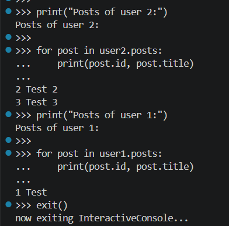
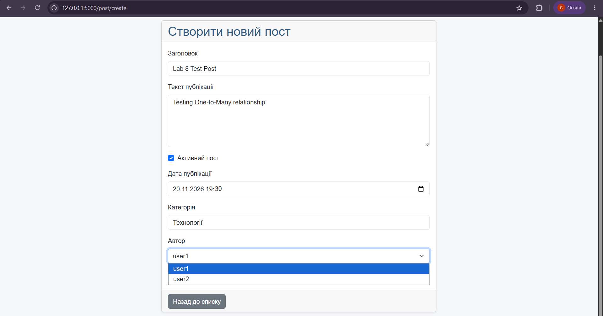
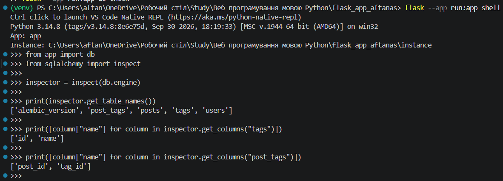
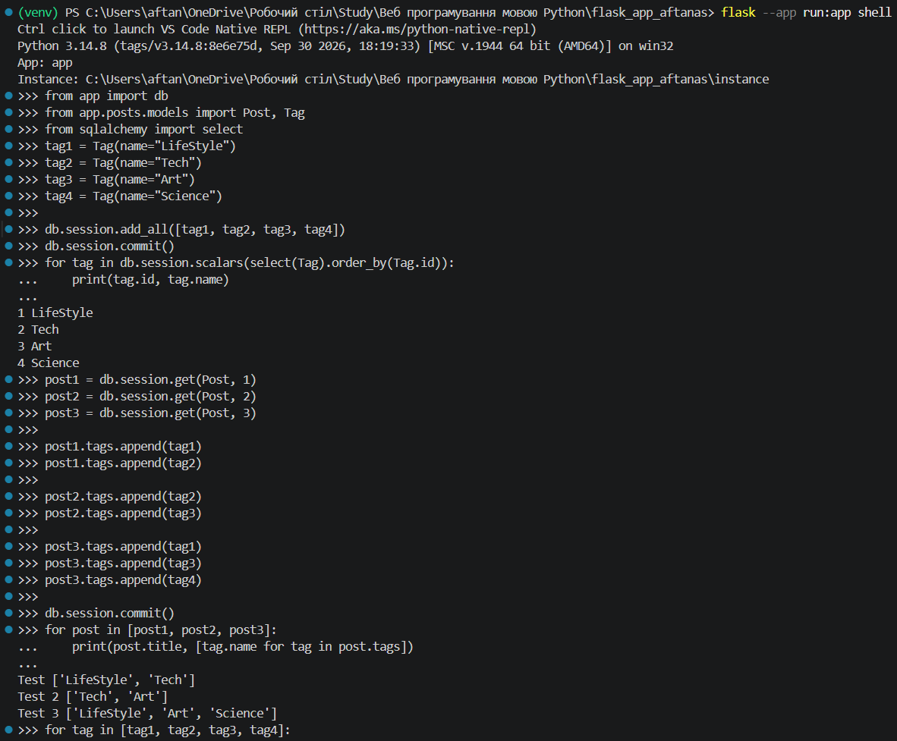
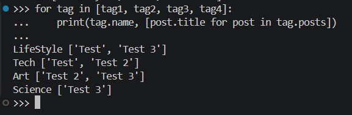
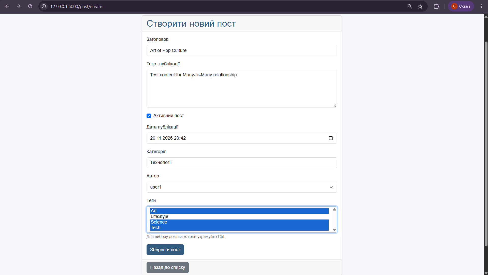
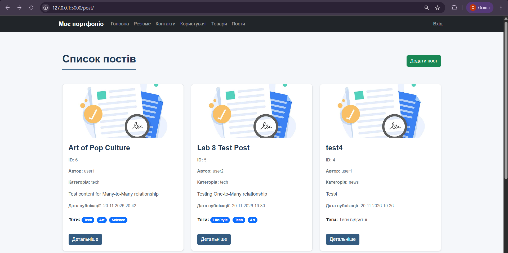
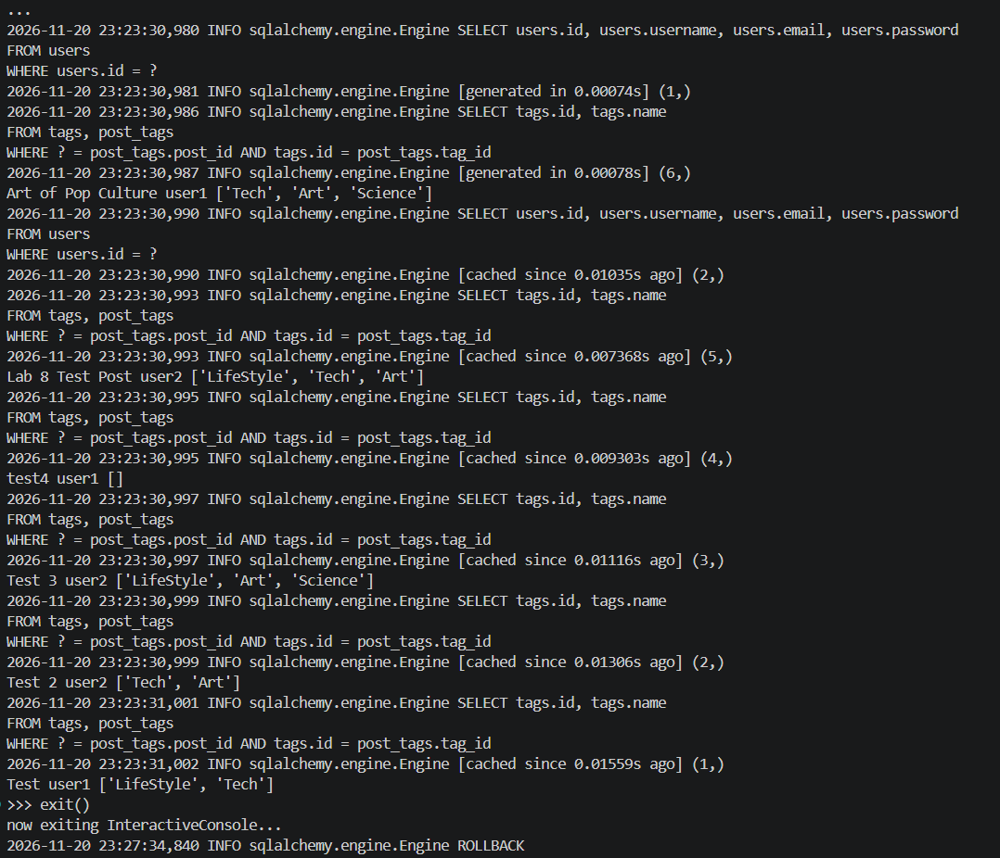
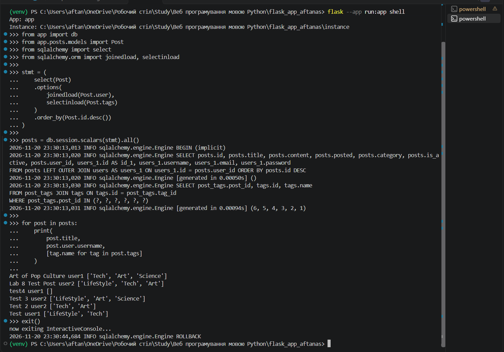

# Лабораторна робота №8

## Тема: Зв'язки між моделями SQLAlchemy

## Мета роботи

- Закріпити знання про створення та використання зв'язків між моделями в SQLAlchemy.
- Навчитися працювати з різними типами зв'язків (One-to-Many, Many-to-Many).
- Ознайомитися з основними операціями над пов'язаними об'єктами.

## Результати виконання

### Пункт 7. Отримання постів користувачів



### Пункт 8. Вибір автора у формі створення поста



### Пункт 9. Реалізація зв'язку Many-to-Many



### Пункт 10. Робота з тегами через Flask Shell





### Пункт 11. Вибір декількох тегів у формі



### Пункт 12. Відображення тегів на картках постів



### Пункт 13. Оптимізація завантаження авторів і тегів

Для дослідження використано 6 постів, 2 авторів та 4 теги.

SQL-журналювання увімкнено за допомогою:

`app.config["SQLALCHEMY_ECHO"] = True`

Обидва варіанти виконувалися в окремих Flask Shell-сесіях.

#### 13.1. Запит без оптимізації

**Код:**

```python
from app import db
from app.posts.models import Post
from sqlalchemy import select

stmt = select(Post).order_by(Post.id.desc())

posts = db.session.scalars(stmt).all()

for post in posts:
    print(
        post.title,
        post.user.username,
        [tag.name for tag in post.tags]
    )
```

**Результат виконання:**

```text
Art of Pop Culture user1 ['Tech', 'Art', 'Science']
Lab 8 Test Post user2 ['LifeStyle', 'Tech', 'Art']
test4 user1 []
Test 3 user2 ['LifeStyle', 'Art', 'Science']
Test 2 user2 ['Tech', 'Art']
Test user1 ['LifeStyle', 'Tech']
```

**SQL-журнал:**



Кількість виконаних SELECT: **9**.

#### 13.2. Запит з оптимізацією

**Код:**

```python
from app import db
from app.posts.models import Post
from sqlalchemy import select
from sqlalchemy.orm import joinedload, selectinload

stmt = (
    select(Post)
    .options(
        joinedload(Post.user),
        selectinload(Post.tags)
    )
    .order_by(Post.id.desc())
)

posts = db.session.scalars(stmt).all()

for post in posts:
    print(
        post.title,
        post.user.username,
        [tag.name for tag in post.tags]
    )
```

**Результат виконання:**

```text
Art of Pop Culture user1 ['Tech', 'Art', 'Science']
Lab 8 Test Post user2 ['LifeStyle', 'Tech', 'Art']
test4 user1 []
Test 3 user2 ['LifeStyle', 'Art', 'Science']
Test 2 user2 ['Tech', 'Art']
Test user1 ['LifeStyle', 'Tech']
```

**SQL-журнал:**



Кількість виконаних SELECT: **2**.

#### 13.3. Порівняльна таблиця

| Варіант запиту | Кількість дописів | Кількість SELECT |
|---|---:|---:|
| Без `.options()` | 6 | 9 |
| Із `joinedload()` та `selectinload()` | 6 | 2 |

Після оптимізації кількість SQL-запитів зменшилася з 9 до 2, тобто на **77,8%**.

