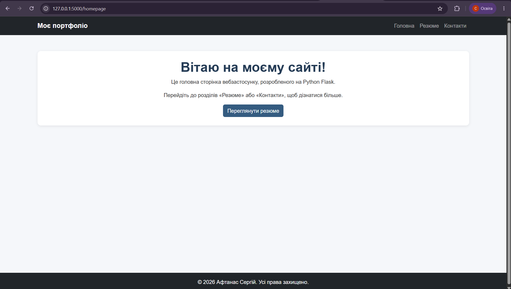
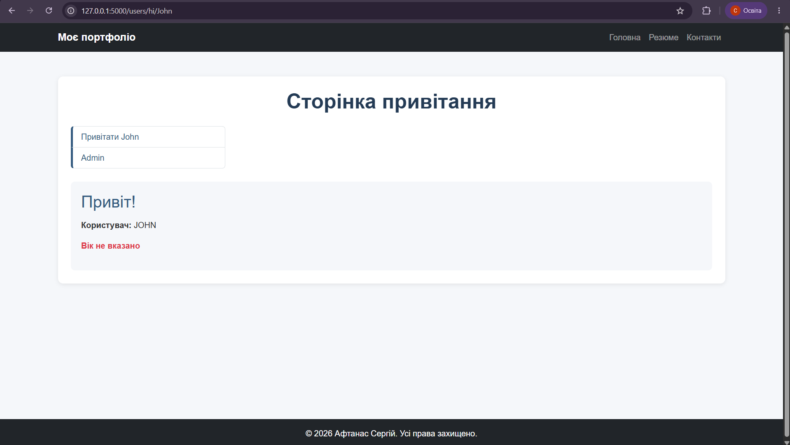
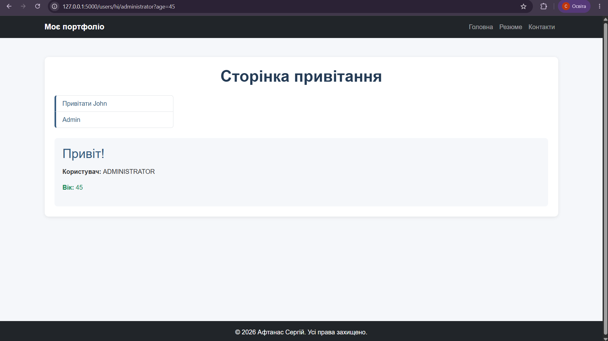

# Лабораторна робота №3

## Тема: Структура Flask-застосунку, Blueprints та модульне тестування

**Мета роботи:** удосконалити структуру вебзастосунку Flask, реалізувати модульну організацію маршрутів за допомогою Blueprints та ознайомитися з модульним тестуванням.

## Завдання 1. Реорганізація структури проєкту

У ході виконання першого завдання було змінено структуру Flask-застосунку:

- Створено пакет `app`.
- Перенесено папки `templates` і `static` всередину `app`.
- Створення екземпляра Flask перенесено до `app/__init__.py`.
- Маршрути винесено до `app/views.py`.
- Створено окремий шаблон `homepage.html`.
- Файл запуску застосунку перейменовано на `run.py`.
- Збережено сторінки «Резюме» та «Контакти» з попередньої лабораторної.

### Результат роботи

Головна сторінка вебзастосунку:

## Завдання 2. Використання Blueprints

### 2.1. Blueprint users

Створено окремий модуль `users`, який зареєстровано у Flask з префіксом `/users`.

Реалізовано такі можливості:

- Динамічний маршрут `/users/hi/<name>` для привітання користувача.
- Отримання віку через параметр `age` у URL.
- Перетворення імені користувача у верхній регістр.
- Використання `url_for()` для формування посилань.
- Перенаправлення з `/users/admin` на сторінку привітання адміністратора.
- Шаблон `hi.html` із наслідуванням `base.html`.
- Вертикальне навігаційне меню та власні CSS-стилі.

### Результати роботи Blueprint users

**1. Привітання користувача без зазначення віку**

Адреса: `/users/hi/John`

**2. Перенаправлення адміністратора**

Адреса: `/users/admin`

Після переходу відбувається перенаправлення на `/users/hi/administrator?age=45`.

