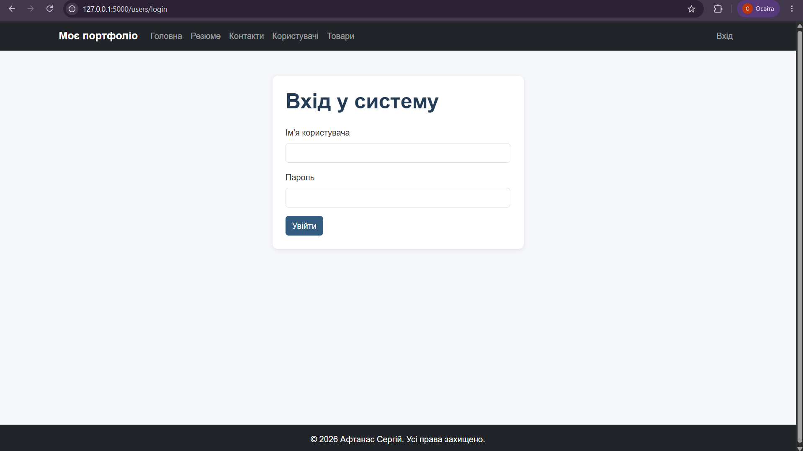
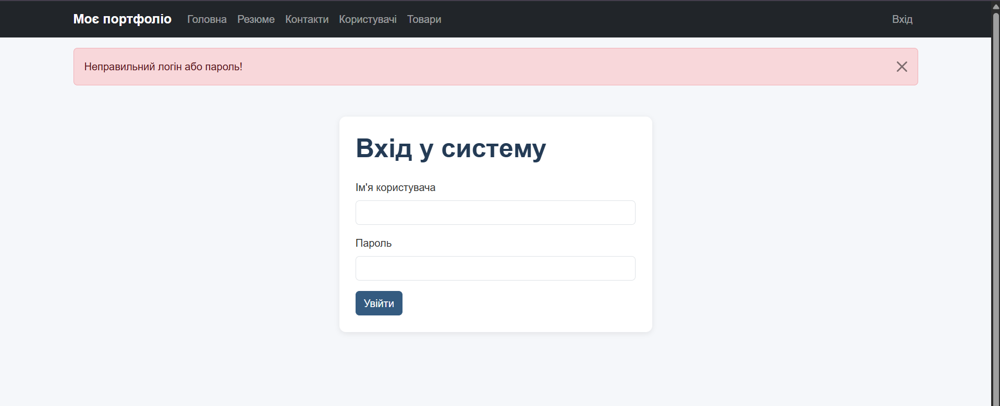
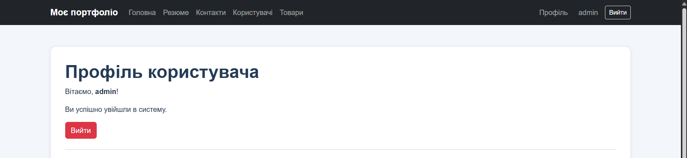
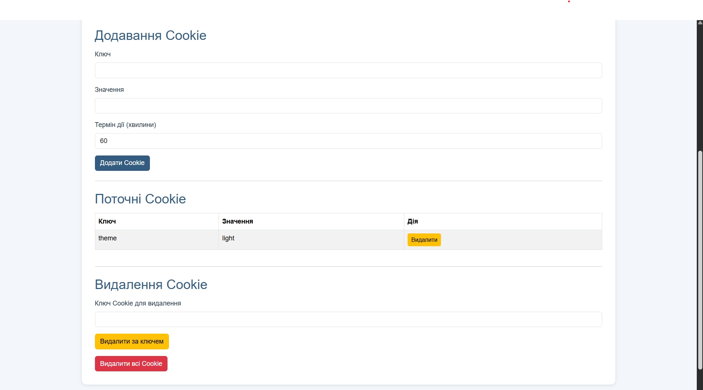
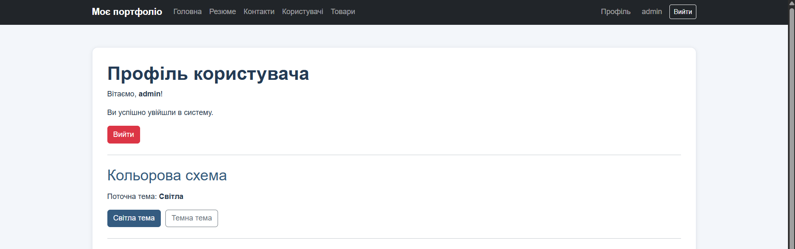
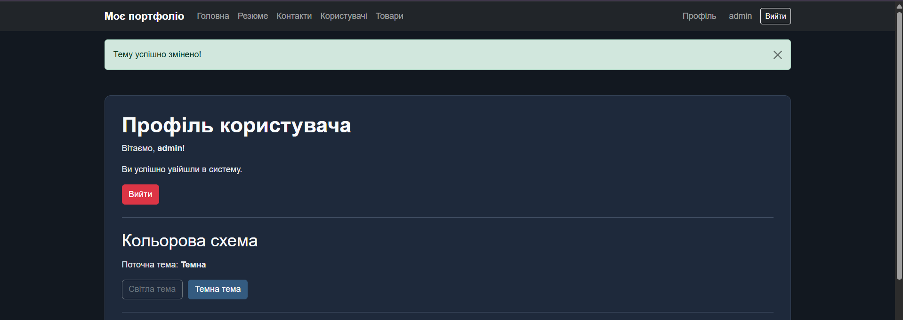

# Лабораторна робота №4

## Тема: Об'єкт запиту request. Сесії та кукі

**Мета роботи:** ознайомитися з обробкою HTTP-запитів у Flask, навчитися використовувати сесії та cookie для збереження даних користувача, реалізувати автентифікацію, flash-повідомлення та персоналізацію інтерфейсу.

## Завдання 1. Авторизація користувача

У Blueprint `users` реалізовано систему авторизації без використання бази даних.

Створено сторінку `/users/login`, яка містить HTML-форму з полями для введення імені користувача та пароля.

Для отримання даних форми використовується об'єкт `request`, зокрема `request.method` і `request.form`.

Перевірка облікових даних виконується за допомогою заздалегідь визначених значень.

При успішній авторизації:
- Ім'я користувача зберігається в `session`.
- Відображається flash-повідомлення категорії `success`.
- Виконується перенаправлення на сторінку профілю.

При неправильних даних:
- Відображається flash-повідомлення категорії `error`.
- Користувач повертається на сторінку входу.

### Результати роботи

**1. Сторінка авторизації**

Адреса: `/users/login`

**2. Повідомлення про помилку авторизації**

При введенні неправильного логіна або пароля відображається повідомлення про помилку.

## Завдання 2. Робота із сесіями

Створено сторінку `/users/profile`, доступ до якої мають лише авторизовані користувачі.

Для перевірки авторизації використовується `session.get("username")`.

Реалізовано:
- Отримання імені користувача із сесії.
- Відображення персонального привітання.
- Перенаправлення неавторизованих користувачів на сторінку входу.
- Відображення flash-повідомлення про відсутність авторизації.
- Можливість виходу із системи.

Для виходу реалізовано маршрут `/users/logout`, який очищає сесію за допомогою `session.clear()` та перенаправляє користувача на сторінку входу.

### Результат роботи

**Сторінка профілю авторизованого користувача**

Адреса: `/users/profile`

## Завдання 3. Навігаційне меню та flash-повідомлення

Модифіковано базовий HTML-шаблон `base.html` та навігаційне меню `_navbar.html`.

У меню додано посилання на:
- Головну сторінку.
- Резюме.
- Контакти.
- Сторінку користувачів.
- Список товарів.
- Профіль користувача.
- Сторінку входу.

Навігаційне меню змінюється залежно від стану авторизації.

Для неавторизованих користувачів відображається посилання «Вхід».

Для авторизованих користувачів відображаються посилання «Профіль», ім'я користувача та кнопка «Вийти».

Реалізовано підтримку flash-повідомлень із категоріями `success`, `error`, `warning` та `info`.

Повідомлення оформлено за допомогою Bootstrap.

## Завдання 4. Керування cookie

На сторінці профілю реалізовано інтерфейс для роботи з cookie.

Створено маршрути:
- `/users/cookies/add` — додавання cookie.
- `/users/cookies/delete` — видалення cookie за ключем.
- `/users/cookies/delete-all` — видалення всіх доступних користувацьких cookie.

Для створення cookie використовується метод `response.set_cookie()`.

Користувач може вказати:
- Ключ cookie.
- Значення cookie.
- Термін дії у хвилинах.

Для видалення cookie використовується метод `response.delete_cookie()`.

Поточні cookie отримуються через `request.cookies` і відображаються у вигляді таблиці, що містить ключ, значення та кнопку видалення.

Системна cookie Flask `session` виключена з таблиці та захищена від видалення через інтерфейс.

Усі операції керування cookie доступні лише авторизованим користувачам.

Після додавання або видалення cookie відображається відповідне flash-повідомлення.

### Результат роботи

**Інтерфейс керування cookie**

## Завдання 5. Вибір теми профілю

Реалізовано можливість перемикання між світлою та темною темами сторінки профілю.

Створено окремий маршрут `/users/theme/<theme>`, який обробляє POST-запити на зміну теми.

Для збереження вибору користувача використовується cookie `theme`.

Реалізовано:
- Світлу тему оформлення.
- Темну тему оформлення.
- Кнопки перемикання кольорової схеми.
- Збереження вибраної теми на 30 днів.
- Автоматичне застосування теми при повторному відвідуванні профілю.
- Flash-повідомлення після зміни теми.

Якщо cookie `theme` відсутня, використовується світла тема.

Стилі оформлення сторінки профілю винесено в окремий файл `app/static/css/profile.css`.

Для підключення стилів використовується блок `extra_css` у базовому шаблоні.

### Результати роботи

**1. Світла тема профілю**

**2. Темна тема профілю**

