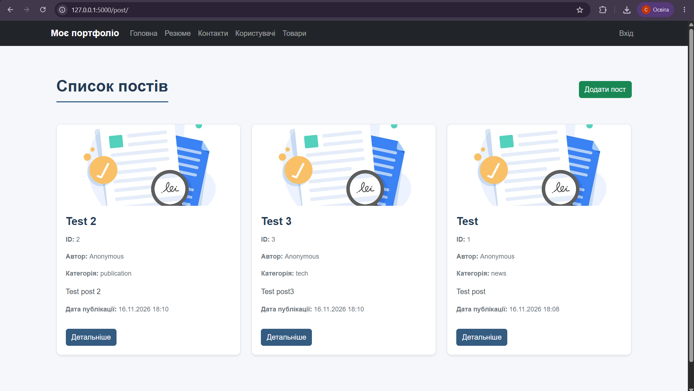
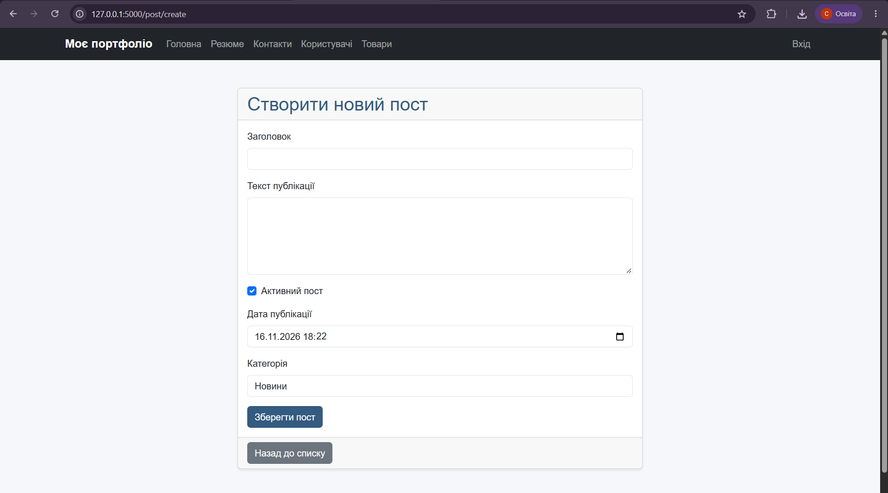
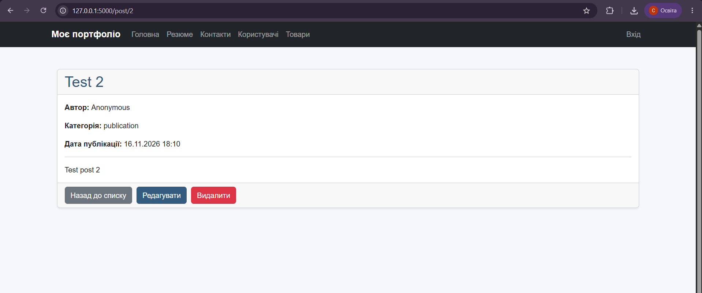
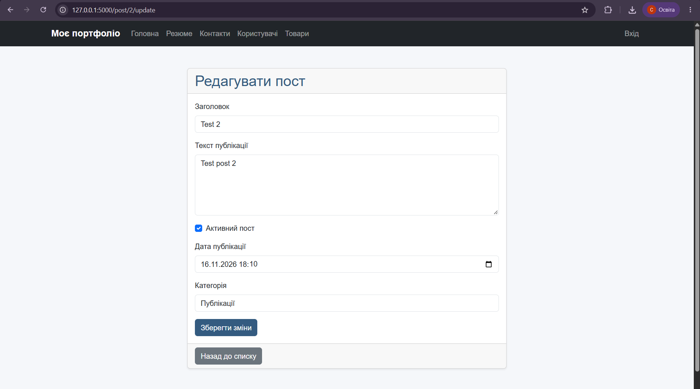
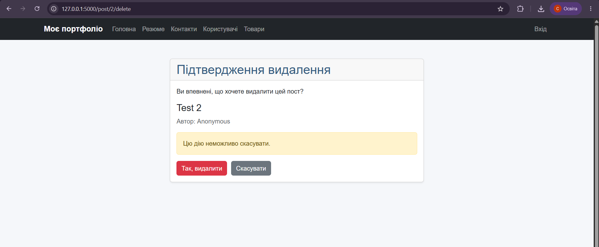
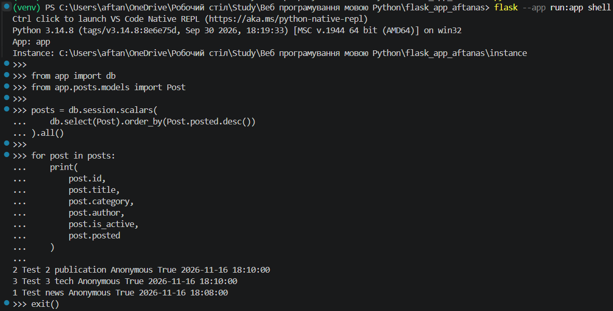
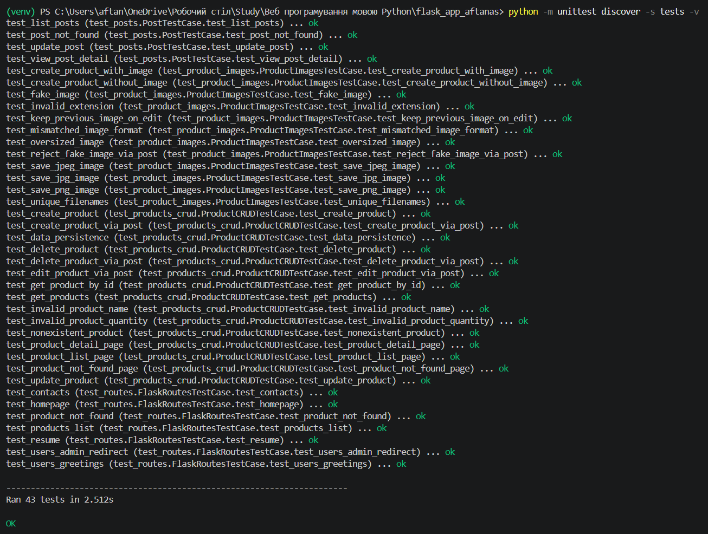

# Лабораторна робота №6

## Тема: Flask-SQLAlchemy, міграції бази даних та CRUD-операції

**Мета роботи:** навчитися використовувати патерн Application Factory, налаштовувати конфігурації Flask-застосунку, працювати з базою даних через Flask-SQLAlchemy, створювати міграції за допомогою Flask-Migrate та реалізовувати CRUD-операції для публікацій.

## Використані технології

- Python 3
- Flask
- Flask-SQLAlchemy
- Flask-Migrate
- SQLAlchemy 2
- SQLite
- Flask-WTF
- WTForms
- Jinja2
- Bootstrap 5
- CSS
- unittest

## Реалізована функціональність

### 1. Application Factory

Реалізовано фабрику `create_app()` для створення Flask-застосунку.

Створено окремі конфігурації:

- `DevelopmentConfig` — для розробки.
- `TestingConfig` — для тестування.
- `ProductionConfig` — для виробничого середовища.

Налаштовано ініціалізацію SQLAlchemy, Flask-Migrate та реєстрацію Blueprint.

### 2. Модель Post

Створено модель `Post` із такими полями:

- `id` — унікальний ідентифікатор.
- `title` — заголовок публікації.
- `content` — текст публікації.
- `posted` — дата публікації.
- `category` — категорія.
- `is_active` — статус активності.
- `author` — автор.

Реалізовано створення, пошук, сортування та видалення записів через Flask Shell.

### 3. Міграції бази даних

Інтегровано Flask-Migrate для керування структурою бази даних.

Створено початкову міграцію таблиці `posts` та наступну міграцію з додаванням полів `is_active` і `author`.

### 4. CRUD-операції

Створено Blueprint `posts` із такими можливостями:

- Створення публікацій через Flask-WTF.
- Відображення списку активних публікацій.
- Перегляд детальної інформації.
- Редагування публікацій.
- Видалення з підтвердженням через POST.
- Flash-повідомлення про виконані операції.

### 5. Оформлення інтерфейсу

Використано Bootstrap 5 та власний файл `posts.css`.

Реалізовано адаптивні картки публікацій, стандартне зображення `default.jpg`, форми створення й редагування, сторінку деталей та підтвердження видалення.

### 6. Тестування

Створено 9 автоматизованих тестів для функціональності публікацій.

Усі 43 тести проєкту успішно пройдено.

Проведено перевірку записів SQLite через Flask Shell.

## Запуск проєкту

Встановлення залежностей:

```bash
pip install -r requirements.txt
```

Налаштування змінних середовища у файлі `.env`:

```env
FLASK_APP=run:app
APP_CONFIG=development
SECRET_KEY=your-secret-key
DATABASE_URL=sqlite:///app.sqlite
```

Застосування міграцій:

```bash
flask --app run:app db upgrade
```

Запуск застосунку:

```bash
python run.py
```

Список публікацій:

`http://127.0.0.1:5000/post/`

## Запуск тестів

```bash
python -m unittest discover -s tests -v
```

**Результат:** 43 тести виконано успішно.

## Результати роботи

### Список публікацій



### Створення публікації



### Детальна інформація



### Редагування публікації



### Видалення публікації



### Перевірка SQLite



### Автоматизоване тестування


