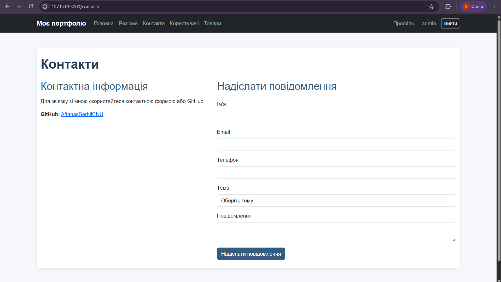
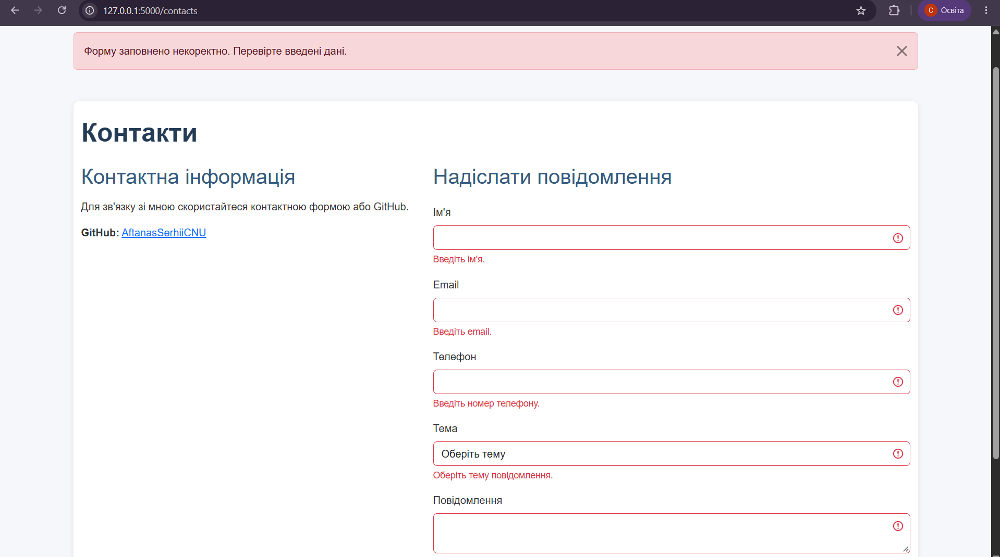
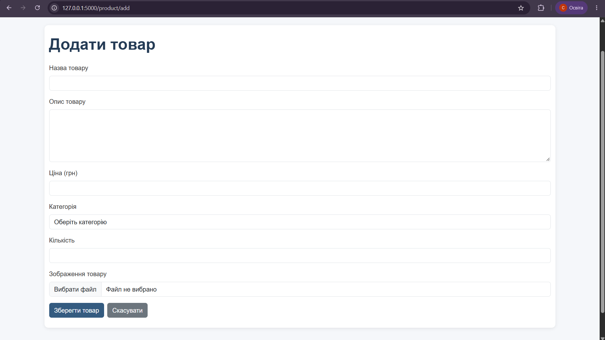
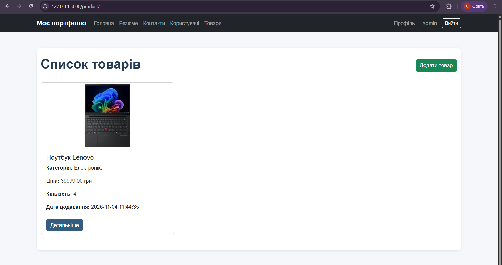
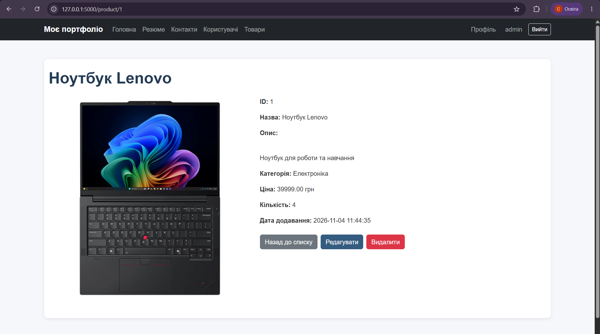
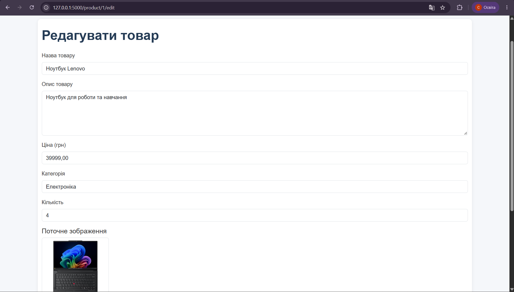
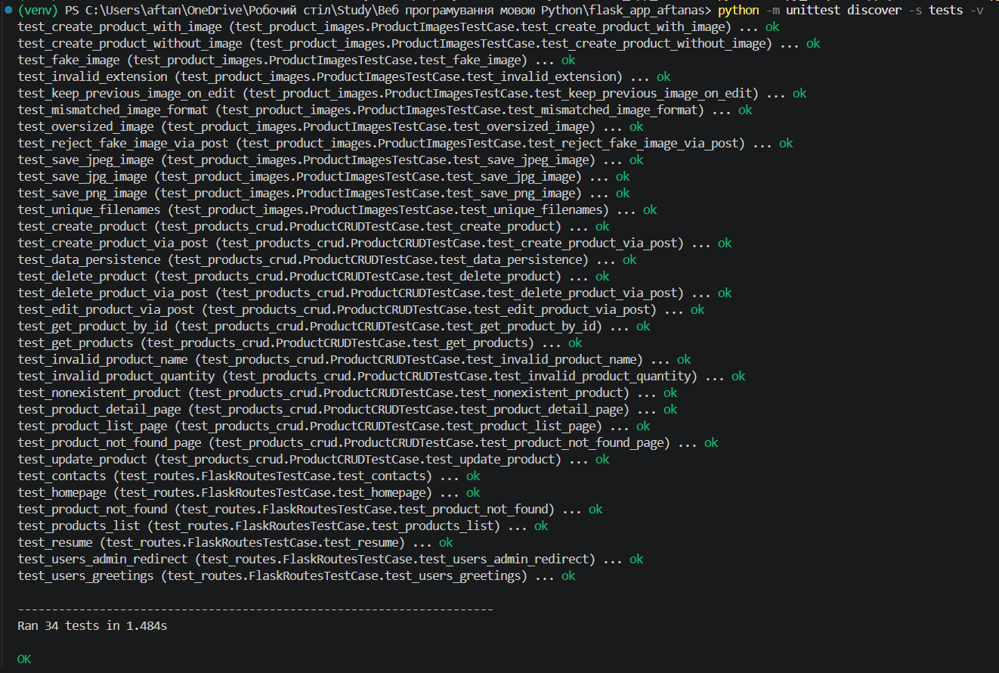

# Лабораторна робота №5

## Тема: WTF-форми

**Мета роботи:** навчитися створювати та обробляти вебформи за допомогою Flask-WTF, застосовувати валідацію введених даних, CSRF-захист, макроси Jinja2, flash-повідомлення та патерн Post/Redirect/Get. Реалізувати CRUD-операції для керування товарами з використанням TinyDB.

## Використані технології

- Python
- Flask
- Flask-WTF
- WTForms
- TinyDB
- Pillow
- Jinja2
- HTML, CSS, Bootstrap
- unittest
- Git

---

# Завдання 1. Контактна форма Flask-WTF

У першому завданні модифіковано наявну контактну форму з використанням бібліотеки Flask-WTF.

Створено окремий модуль `app/forms.py`, який містить клас `ContactForm`, успадкований від `FlaskForm`.

### Поля форми

| Поле | Тип | Валідація |
|---|---|---|
| name | StringField | Обов'язкове, від 4 до 10 символів |
| email | StringField | Обов'язкове, правильний формат email |
| phone | StringField | Формат +380XXXXXXXXX |
| subject | SelectField | Обов'язковий вибір зі списку |
| message | TextAreaField | Обов'язкове, максимум 500 символів |
| submit | SubmitField | Кнопка надсилання |

### Реалізована функціональність

- Створення контактної форми за допомогою Flask-WTF.
- Використання валідаторів WTForms для перевірки введених даних.
- Захист форми від CSRF-атак.
- Створення макроса Jinja2 для відображення полів.
- Виведення повідомлень про помилки під відповідними полями.
- Використання flash-повідомлень із категоріями `success` та `error`.
- Обробка GET- і POST-запитів.
- Реалізація патерну Post/Redirect/Get після успішного надсилання.
- Збереження даних правильно заповнених форм у лог-файл.

Для обробки форми використовується метод `validate_on_submit()`, який перевіряє правильність введених даних.

Після успішного надсилання інформація записується у файл `logs/contact_messages.log`, після чого користувач перенаправляється на сторінку контактів.

Для логування використовується стандартний модуль Python `logging` та `RotatingFileHandler`.

### Основні файли

- `app/forms.py` — клас контактної форми та валідатори.
- `app/views.py` — маршрут і логіка обробки контактної форми.
- `app/templates/contacts.html` — HTML-шаблон контактної сторінки.
- `app/templates/_render_field.html` — макрос відображення полів та помилок.
- `app/templates/base.html` — підтримка flash-повідомлень.

### Результати роботи

**Контактна форма Flask-WTF**



**Валідація полів і відображення помилок**



---

# Завдання 2. CRUD-операції з використанням TinyDB

У другому завданні модифіковано Blueprint `products`, реалізовано збереження товарів у TinyDB та використання Flask-WTF для створення й редагування товарів.

Замість звичайного Python-списку використовується база даних TinyDB, яка зберігає інформацію у JSON-файлі `data/products.json`.

## Структура товару

Кожен товар містить такі поля:

| Поле | Призначення |
|---|---|
| id | Унікальний ідентифікатор товару |
| name | Назва товару, мінімум 3 символи |
| content | Опис товару |
| price | Додатна ціна з точністю до двох знаків |
| category | Категорія із заданого списку |
| quantity | Невід'ємна ціла кількість |
| image | Відносний шлях до зображення |
| created_at | Дата та час створення товару |

Ідентифікатори створюються автоматично за допомогою `doc_id` TinyDB.

Дата створення встановлюється автоматично при додаванні товару та залишається незмінною під час редагування.

## Реалізація CRUD

Реалізовано чотири основні операції для керування товарами.

| Операція | HTTP-метод | Маршрут |
|---|---|---|
| Create | GET, POST | `/product/add` |
| Read | GET | `/product` |
| Read Detail | GET | `/product/<int:product_id>` |
| Update | GET, POST | `/product/<int:product_id>/edit` |
| Delete | POST | `/product/<int:product_id>/delete` |

### Create — додавання товару

Для додавання товару створено Flask-WTF форму `ProductForm`.

Вона містить поля назви, опису, ціни, категорії, кількості та зображення.

Після успішної валідації дані зберігаються в TinyDB, автоматично встановлюються ідентифікатор та дата створення.

Користувач отримує flash-повідомлення та перенаправляється на сторінку створеного товару.

**Форма додавання товару**



### Read — перегляд товарів

Реалізовано сторінку списку товарів із відображенням:

- Назви товару.
- Категорії українською мовою.
- Ціни з двома знаками після коми.
- Кількості одиниць.
- Дати та часу додавання.
- Зображення товару.

Для кожного товару передбачено перехід на сторінку детального перегляду.

**Список товарів**



**Детальна інформація про товар**



### Update — редагування товару

Реалізовано можливість редагування наявних товарів за допомогою Flask-WTF.

При відкритті сторінки редагування поля форми автоматично заповнюються поточними даними товару.

Користувач може змінити назву, опис, ціну, категорію, кількість і зображення.

Якщо нове зображення не вибране, зберігається попереднє.

Під час редагування ідентифікатор `id` і дата створення `created_at` залишаються незмінними.

**Форма редагування товару**



### Delete — видалення товару

Для видалення товару реалізовано POST-маршрут із CSRF-захистом.

Перед видаленням користувач отримує діалог підтвердження дії.

Після підтвердження запис видаляється з TinyDB, відображається flash-повідомлення та виконується перенаправлення на список товарів.

Якщо товар із вказаним ідентифікатором не існує, повертається HTTP 404.

---

## Робота із зображеннями

Для завантаження зображень використовується `FileField` із Flask-WTF та бібліотека Pillow.

Реалізовано:

- Підтримку форматів PNG, JPG та JPEG.
- Обмеження розміру зображення до 2 МБ.
- Перевірку фактичного формату файлу.
- Відхилення пошкоджених і некоректних зображень.
- Генерацію унікальних назв файлів за допомогою UUID.
- Безпечну обробку імен файлів через `secure_filename`.
- Збереження зображень у `app/products/static/uploads/`.
- Збереження відносного шляху до зображення в TinyDB.
- Можливість створення товару без зображення.
- Збереження попереднього зображення під час редагування.

## Зберігання даних

Для роботи з TinyDB створено окремий модуль `app/products/database.py`.

Основні функції:

- `get_database()` — ініціалізація TinyDB.
- `get_products()` — отримання списку товарів.
- `get_product()` — пошук товару за ID.
- `create_product()` — створення товару.
- `update_product()` — оновлення інформації.
- `delete_product()` — видалення товару.

Дані зберігаються у JSON-файлі та залишаються доступними після перезапуску Flask-застосунку.

## Основні файли Blueprint products

- `app/products/__init__.py` — налаштування Blueprint.
- `app/products/views.py` — маршрути CRUD.
- `app/products/forms.py` — Flask-WTF форма товару.
- `app/products/database.py` — робота з TinyDB.
- `app/products/images.py` — перевірка та збереження зображень.
- `app/products/templates/products/products.html` — список товарів.
- `app/products/templates/products/detail_product.html` — детальна інформація.
- `app/products/templates/products/add.html` — додавання товару.
- `app/products/templates/products/edit.html` — редагування товару.

---

# Автоматизоване тестування

Для перевірки роботи застосунку використано стандартний модуль Python `unittest`.

Створено тести для перевірки CRUD-операцій, валідації даних, роботи із зображеннями та HTTP-маршрутів.

### Тестові файли

| Файл | Кількість тестів |
|---|---:|
| `tests/test_products_crud.py` | 15 |
| `tests/test_product_images.py` | 12 |
| `tests/test_routes.py` | 7 |
| **Усього** | **34** |

Тести CRUD та зображень використовують тимчасові каталоги й окрему базу TinyDB, що дозволяє виконувати перевірки без зміни основних даних застосунку.

### Запуск тестів

```powershell
python -m unittest discover -s tests -v
```

### Результат

```text
Ran 34 tests in 1.484s

OK
```

Усі 34 тести успішно пройдено без помилок і попереджень.



---