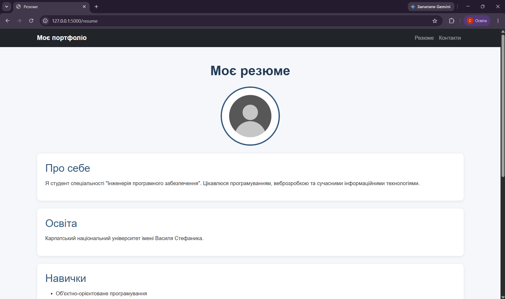
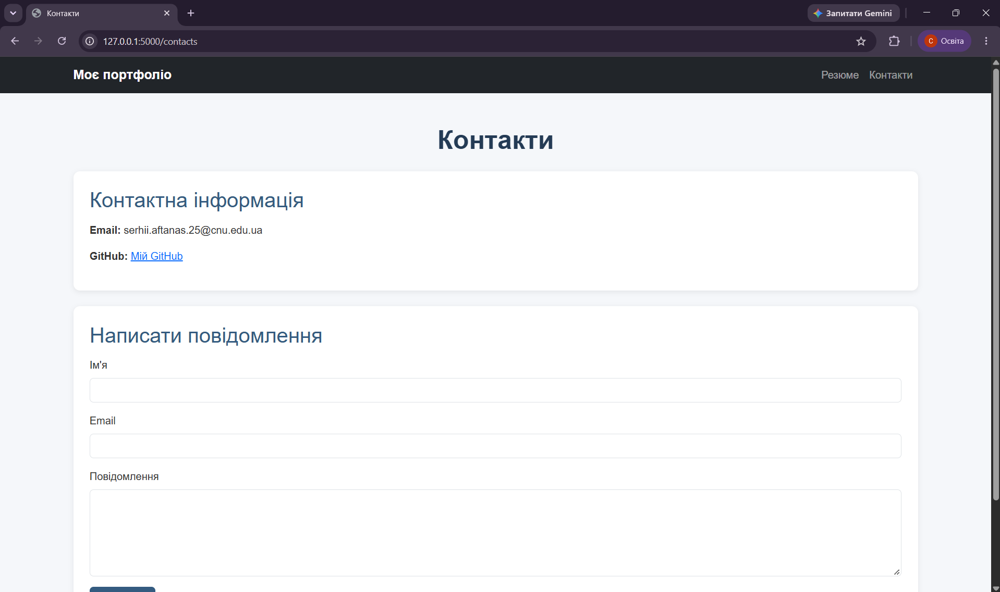

# Лабораторна робота №2

## Тема: Маршрутизація та шаблони

**Мета роботи:** ознайомитися з маршрутизацією у Flask, використанням шаблонізатора Jinja2, наслідуванням шаблонів та підключенням статичних ресурсів.

## Опис роботи

У ході лабораторної роботи розроблено невеликий вебсайт, який складається з двох сторінок: «Резюме» та «Контакти».

Реалізовано:
- Маршрутизацію за допомогою Flask.
- Наслідування HTML-шаблонів через Jinja2.
- Використання `include` для навігаційного меню та футера.
- Динамічну передачу заголовків сторінок.
- Підключення Bootstrap та власних CSS-стилів.
- Відображення зображення через `url_for()`.
- Форму зворотного зв'язку без реальної відправки повідомлень.

## Результати роботи

### 1. Сторінка «Резюме»

Сторінка містить інформацію про себе, освіту, навички, технології та виконані проєкти.

### 2. Сторінка «Контакти»

Сторінка містить контактну інформацію та HTML-форму для введення імені, електронної пошти й повідомлення.

## Використані технології

- Python
- Flask
- HTML5
- CSS3
- Bootstrap 5
- Jinja2

## Посилання на GitHub

[Переглянути лабораторну роботу №2 — гілка lab2](https://github.com/AftanasSerhiiCNU/flask-app-lab/tree/lab2)

